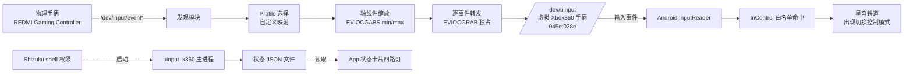

# 架构设计

本文描述 ControllerStarRail v2 的数据流、分层模块与生命周期。

## 1. 数据流



物理事件经 `read()` → 映射 / 缩放 → `write()` 到 uinput 节点，全程逐事件、不做批量缓冲；震动、LED 等反向能力不在范围内。

## 2. native 层（uinput_x360.c）

| 模块 | 职责 |
| --- | --- |
| 发现 | 扫描 event0–127，按 `EVIOCGNAME` / `EVIOCGID` / `EVIOCGBIT` 判定手柄，支持纯数字按键设备；通过 sysfs 排除自身 virtual input，保留同名真实物理手柄；支持热插拔重连 |
| Profile | 内置 `auto/redmi/xbox/ps/android/switch/generic`，按设备名 / VID:PID 或轴布局自动选择；`--config` 加载自定义按键 / 轴映射 |
| 缩放 | 读取物理轴 `EVIOCGABS` 的 min/max，把值线性映射到虚拟 Xbox360 轴范围（摇杆 16 位、扳机 0–255 等） |
| 转发 | `EVIOCGRAB` 独占物理设备防双重输入；创建 uinput 设备并逐事件 `write()`；断开自动重连、虚拟设备常驻不掉线 |
| 守护 | `--detach` 用 fork + setsid 脱离 App 与 Shizuku 生命周期，stdio 全部重定向，避免占住 Shizuku 的 exec 管道 |
| 单例 | pid 文件 + flock 保证同一前缀仅一个实例；`--stop` 按 pid 文件终止 |
| 状态 | 将运行状态写为 JSON 文件（见 [USAGE.md](USAGE.md)）供 App 读取；`--prefix` 指定 pid / log / status 文件前缀 |

命令行入口：`--list` 枚举、`--device` 按 event 路径或 VID:PID 指定设备、`--profile` 选 Profile、`--config` 自定义映射、`--prefix` 文件前缀、`--no-grab` 不独占、`--detach` 脱离常驻、`--stop` 停止、`--help` 帮助。完整说明见 [USAGE.md](USAGE.md)。

## 3. App 层（com.controllerstar.x360bridge）

- **UI（纯 Java，无 AndroidX）**：按 Shizuku → 物理手柄 → 桥进程排序的三步状态卡，主按钮随进度切换；Shizuku 弹窗提供安装、启动、授权与重查；设备列表显示连接方式、VID:PID、建议 Profile 和扳机类型，高级映射与自启设置保持可选。
- **Shizuku UserService + AIDL**：以 shell 身份执行 native 命令、读取状态 JSON、传递启停与参数。
- **二进制选择**：按 `Build.SUPPORTED_ABIS` 从 `assets/bin/<abi>/uinput_x360` 释放对应架构的静态程序。
- **BOOT_COMPLETED 接收者 + 短暂前台服务**：开机后轮询重试拉起桥，受第 4 节边界约束。
- **通知栏控制 / 快捷设置磁贴**：无需打开 App 即可启停。

## 4. Shizuku 权限边界

- App 自身无 shell 权限；一切 native 执行都经 Shizuku 的 `UserService` 以 shell 身份运行。
- 授权一次后长期记住，但**无 root 时设备重启后仍可能需要 Shizuku 重新启动一次**（官方手册要求）。例外：Shizuku 13.6.0+ 在 Android 13+ 连接「可信 WLAN」时可无 root 自动启动。
- 权限仅用于：枚举输入设备、打开 `/dev/uinput`、创建虚拟设备、`EVIOCGRAB`；不申请网络权限、不收集数据。
- GKD 依赖无障碍服务，无法创建 `/dev/uinput`；Dhizuku 的 Device Owner 不提供任意 shell 执行。二者均不适用。

## 5. 身份预设与轴绑定

### 5.1 为什么默认伪装成 045e:028e

星穹铁道的 InControl 按设备名 / VID:PID 白名单匹配 profile，命中项形如 `Microsoft X-Box 360 pad`。虚拟设备须同时满足 `BUS_USB` + vendor `0x045e` + product `0x028e` + version `0x0110` + 名称 `Microsoft X-Box 360 pad` + 标准 Xbox360 按键 / 轴布局，才会被白名单与 InControl 的 Xbox360 profile 同时接受。改蓝牙别名不改变输入设备上报的名称与 ID，因此无效。这也是无法靠 GKD / 无障碍浮层绕过的根本原因——必须先有一个被内核承认的 uinput 设备。

0.3.0 起这组身份不再是编译期常量，而是运行时的 `IDENTITIES[]` 预设表：`xbox360`（默认）、`xboxone`、`xboxbt`、`ds4`、`dualsense`，由 `--identity` 选择。`create_virtual_device()`、`looks_like_gamepad()`（排除自身）与 `write_status()` 全部读取当前选中的预设；切换身份后不会再把自己当物理手柄 `EVIOCGRAB`。非默认身份为实验性，详见 [兼容性说明](COMPATIBILITY.md) 第 8 节。

### 5.2 一个虚拟轴只接一个物理源

0.2.x 用「Profile 轴表」做 `from → to` 映射，同一 `to` 可能被多个 `from` 写入，且 `GAS` / `BRAKE` 左右写反，这是 LT/RT 错位的根源。0.3.0 在 `open_physical()` 时按实际 `EV_ABS` / `EV_KEY` 能力与 `EVIOCGABS` 量程构造 `bind[ROLE_COUNT]`：

```
物理 event 轴 ──► role_for_src() ──► 唯一角色 ──► emit_axis_value()
                                        │
                                        ├─ 扳机：静止归一 / 自适应量程 / 自动二值
                                        ├─ 摇杆：按 lo..hi 线性缩放到虚拟轴
                                        └─ HAT：原样钳制到 -1..1
未绑定的轴直接丢弃（不再 passthrough 猜测）
```

`--config` 的 `axis` 规则可覆盖任意角色绑定；`--legacy-mapping` 可回退旧轴表。按键式扳机 `BTN_TL2` / `BTN_TR2` 在没有对应轴时转成 `ABS_Z` / `ABS_RZ`；按钮式十字键对所有 Profile 都转成 `ABS_HAT0X/Y`。启动日志会打印完整绑定表，是排查错位的第一入口。

## 6. 常驻与开机自启时序

```
App 启动 → 检查 Shizuku 授权 → 连接 UserService
  → 释放 assets/bin/<abi>/uinput_x360
  → 执行 uinput_x360 --detach --prefix <占位前缀> [--profile auto]
  → fork + setsid 后子进程独立，父进程退出，stdio 重定向，Shizuku exec 管道释放
  → 虚拟 uinput 设备常驻，热插拔自动重连
  → App 周期读取状态 JSON 刷新四路灯
```

设备重启后：

```
BOOT_COMPLETED → 短暂前台服务启动 → 轮询 Shizuku 是否可用
  → 可用则重新执行 --detach 拉起桥；不可用则退避重试
  → 受第 4 节约束：无 root 且 Shizuku 未自动启动时，仍需用户手动重启 Shizuku
```

> 目标效果是「启动后桥独立常驻，直到设备重启前都不需要再开 Shizuku / 无线调试 / App」；本项目不宣称 100% 免 Shizuku、不 root。

## 相关文档

[使用说明](USAGE.md) · [兼容性](COMPATIBILITY.md) · [README](../README.md)
